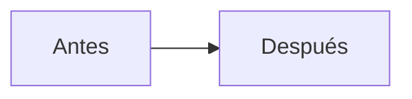

# TODO — Flujo agéntico del repo (plan vivo)

> **Este documento es la memoria del plan entre sesiones.** Si eres un agente y
> retomas: lee hasta el final la sección «Cómo retomar», revisa la tabla de estado y
> continúa por el primer checkbox sin marcar. No reabras decisiones cerradas sin
> evidencia nueva (anótala en la Bitácora).
>
> No sustituye a `AGENTS.md` (memoria del proyecto) ni a `DEPLOY.md`.

Creado: 2026-10-19. Última actualización: 2026-10-21 (M0 en curso).

## Cómo retomar este plan

1. `git status` y `git log --oneline -5`: mira en qué estado está el repo.
2. Lee este documento completo y `AGENTS.md` (convenciones del repo).
3. Mira la tabla **Estado de las fases** y la **Bitácora** (final del documento).
4. Continúa por el **primer checkbox sin marcar** de la primera fase no completada.
5. Al terminar la sesión: marca lo hecho, actualiza la tabla de estado y añade una
   entrada a la Bitácora con: qué se hizo, qué se aprendió, qué queda y el siguiente
   paso concreto.
6. Si contradices una decisión cerrada, escribe antes la evidencia nueva y por qué.
   Las decisiones cerradas están abajo; no se tocan por preferencia.

Convención de marcado:

- `- [ ]` pendiente
- `- [x]` hecho (con fecha y nota si hace falta)
- `- [!]` bloqueado (con el motivo y quién lo desbloquea)
- `- [-]` descartado (con el motivo)

## Estado de las fases

| Fase | Estado | Siguiente acción |
|---|---|---|
| M0 — Base | Hecho (2026-10-22) | — |
| M1 — Imagen del worker | Hecho (2026-10-22) | — |
| M2 — CLI `orquestator-cli` | Hecho (2026-10-22) | — |
| M3 — Perfiles de fase | Hecho (2026-10-24) | — |
| M4 — Piloto | Hecho (2026-10-24) | — |
| M5a — Preview | Pendiente | Diseñar el preview con D1/R2 propios |
| M5b — Automatización | Pendiente | `watch`, job `guard` y bucle automático de spec |
| M6 — Después del piloto | Pendiente | Evaluar tras M5b |

## Referencias y hechos verificados

### Fuentes primarias (filosofía)

1. **Vídeo «No construyas skill, construye environments»** — Gurusup Community,
   https://youtu.be/w6X_hk7DDws (publicado 2026-09-29, ≈45 min). Transcripción
   auto-generada consultada el 2026-10-19. Ideas que sostienen este plan:
   - El problema del local no escala: cada persona acumula memorias, skills y
     configuraciones divergentes; el arnés acaba capando al modelo.
   - Pipeline remoto con fases: init → diagnóstico (opcional) → spec → implementación
     TDD → loop de validación + review → e2e → vídeo demo → PR.
   - Aislamiento: imagen de Docker fresca por tarea y VM que se apaga al terminar;
     cada tarea con su propia BD/servicios.
   - Review en **contexto limpio** (no el mismo que implementa); límites de iteración;
     los hallazgos críticos vuelven, el resto se anota.
   - «Una skill no fuerza el proceso»: el proceso se impone con estructura
     (estados, comprobaciones, límites), no con súplicas al modelo.
   - Las comprobaciones son la única prueba de verdad; el agente no puede cambiar la CI que
     lo controla.
   - El sistema está diseñado para la atención humana: resumen, preguntas concretas,
     algo que probar.

2. **Artículo «Cómo trabajo sin escribir una línea de código»** — `cpto-10-x.md`
   (copia local en `/home/ifmael/Downloads/cpto-10-x.md`; CPTO 10x). Ideas que
   sostienen este plan:
   - El trabajo se organiza alrededor de tareas de producto; Linear como máquina de
     estados (Revisión de spec → Lista → En curso → En validación → Hecho).
   - Un agente revisor de la spec, escéptico, devuelve preguntas numeradas; la
     descripción se actualiza con lo acordado; el humano decide cuándo está lista.
   - Implementación con comprobaciones: tests con cobertura, e2e si toca interfaz,
     migraciones reversibles, ADR cuando hay decisión, revisión de código por **otro
     agente**; la CI decide, no el agente.
   - Entorno de prueba por PR con datos inventados; el humano valida ahí.
   - El agente no puede modificar la CI que lo controla.
   - ADRs como memoria; el sistema diseñado para la atención (resumen + preguntas +
     entorno de prueba).

### Hechos técnicos verificados (2026-10-19; v2 y M0: 2026-10-21)

- **Cloudflare D1 (2026-10-21)**: `POST /accounts/{id}/d1/database/{db}/query` acepta
  `D1 Read` **o** `D1 Write` (referencia de la API), así que el token read-only de la CI
  puede leer `d1_migrations`. Falta comprobarlo con el token real. `database_id` de
  `esencial`: `989acff9-fbad-4ef7-a001-695d4966d264`; el account id no está en el repo.

- **Linear Free** ($0): miembros ilimitados, 2 equipos, **250 issues no archivadas**
  (archivar libera cupo), API + webhooks + MCP, integración GitHub, detección de
  previews. Fuentes: https://linear.app/pricing, https://linear.app/docs/github,
  https://linear.app/docs/mcp.
- **Hermes Agent** ya instalado: v0.19.0 (2026.7.20) vía mise/pipx, sin provider
  configurado. Soporta providers OpenAI-compatible personalizados, worktrees nativos,
  perfiles, kanban SQLite, cron, heartbeats, loops, goals, MCP, webhooks, canales,
  delegación con aislamiento por worktree, memoria con Hindsight y contexto
  `AGENTS.md`. Fuentes: https://hermes-agent.nousresearch.com/docs/llms.txt y sus
  páginas de `configuring-models`, `git-worktrees`, `features/kanban`,
  `features/cron`, `features/delegation`, `features/mcp`, `features/memory-providers`,
  `features/context-files`.
- **omp** v18.11.2: subagentes con aislamiento por workspace (`isolated`), perfiles
  de agente, overrides de modelo, Agent Hub, herramienta `gh` (PR/worktrees),
  `-p` headless. Es el **plan B** de worker. Fuentes: `omp://tools/task.md`,
  `omp://tools/github.md`, `omp://vibe-mode.md`, `omp://agent-hub.md`.
- **Repo (v2)**: `.git` 20 MB (12,27 MiB de `size-pack`); git del host 2.56.0.
- **Máquina**: 16 núcleos, 30 GiB de RAM, 437 GB libres. Docker 29.7.2 instalado con
  el daemon **inactivo**. `gh` 2.102.0 instalado, sin autenticar. Node del CI: 24.
- **Repo**: CI en `.github/workflows/ci.yml` (typecheck, test, e2e, lint; PR y push a
  `main`); `pnpm e2e` aísla su estado (`e2e/.state`) y acepta `E2E_WEB_PORT` y
  `E2E_API_PORT` para varios worktrees; pre-commit de husky; deploy automático a
  Cloudflare al mergear. Todo documentado en `AGENTS.md`.

### Cómo se sintetizan las fuentes

| Decisión del plan | Fuente principal |
|---|---|
| Linear como estado de producto | Artículo (ciclo de tarea) + decisión de la sesión |
| Spec revisada por un agente escéptico, con N rondas | Artículo + vídeo (fase spec) |
| Implementación TDD con comprobaciones | Vídeo (TDD) + artículo (comprobaciones) + repo (TDD estricto) |
| Review en contexto limpio, distinto del implementador | Vídeo + artículo (otro agente) |
| Contenedor efímero por fase (clon persistente) | Vídeo (imagen fresca) + artículo (runner efímero) + I2 |
| Clon local por tarea | Repo (e2e por worktree) + fuentes (aislamiento) + C2-A |
| Orquestador determinista | Vídeo («una skill no fuerza el proceso») + artículo (orquestador propio) |
| PR con resumen, diagrama y preview | Artículo (entorno de prueba por PR) + decisión de la sesión |
| El agente no toca la CI | Artículo (regla explícita) |
| Modelos distintos por fase | Vídeo (perfiles) + suscripción de nan del usuario |
| Hermes como agente | Decisión de la sesión; el vídeo usa Hermes; el artículo, un orquestador propio |

## Decisiones cerradas

| Tema | Decisión |
|---|---|
| Estado de las tareas | **Linear Free** (1 equipo, clave `ESN`; estados `Backlog → Spec review → Ready → In Progress → In validation → Done`, más `Blocked`; auto-archivado) |
| Ejecución | **Local**, sin Orca. Un **clon local por tarea** (C2-A) y un **contenedor efímero por fase** que monta ese mismo clon; el clon y sus commits persisten entre fases |
| Orquestador | **CLI determinista en el piloto** (`run`): el agente decide dentro de su fase; el CLI encadena y valida. El coordinador (Nivel 2, forma 2) se evalúa en M5b |
| Orquestación | **Un `run` por tarea** (D1-A): `watch` despacha y `run` encadena las fases; sin coordinador en el piloto. El coordinador por tarea (forma 2) queda como opción de M5b |
| Confianza | **C3-A**: el host solo usa git/gh con hooks y fsmonitor desactivados y `--no-verify`; nunca ejecuta `pnpm` del repo. **Nunca corre git con `cwd` en el clon**: importa la rama al checkout principal y hace los diffs ahí con `--no-ext-diff --no-textconv`. El `.git` principal nunca se monta (C2-A) |
| Coordinador (C4) | **M5b, opcional** (no en el piloto): si se añade, A+ (toolset mínimo con plugin `orquestator` e `inspect`, sin `terminal`, `file` de escritura, `web`, `browser`, `delegation` ni `gh`) y B (token solo en el CLI). `approve`/`clean` no se exponen |
| Red y secretos (C5) | **B**: proxy de modelo mínimo (Caddy/nginx) con la clave real; worker en red interna sin salida; store de pnpm horneado; `--cpus`, `--memory`, `--pids-limit`, no-root, `cap-drop=ALL`, `no-new-privileges`. **MCP por perfil** solo si un perfil lo necesita (M5b/M6) vía gateway/sidecar; en el piloto no hay MCPs |
| Agente | **Hermes** (v0.19; provider custom de nan). Sin bake-off; el CLI habla con Linear por API, no por MCP |
| Ejecutor de fases | Hermes dentro del contenedor. **Intercambiable**: omp es el plan B |
| Modelos | nan, un modelo distinto por fase. Piloto: `implementer`, `reviewer`, `pr-reviewer` y `spec-reviewer`. Después del piloto (backlog): `test-auditor` y `security-auditor` |
| Tests | El `implementer` escribe plan de pruebas y código (TDD); el `reviewer` audita contra la spec; negativos obligatorios; no se debilita un test existente |
| Review | Uno previo a la PR (`reviewer`, contexto limpio) y otro sobre la PR publicada (`pr-reviewer`, contexto limpio y modelo distinto) |
| Validación | PR con resumen + diagrama + preview de Cloudflare; el humano valida y mergea |
| Comprobaciones | `lint`, `typecheck`, `test` (con cobertura), `e2e` + la CI existente |
| Integridad de las comprobaciones | **C1-A**: rutas protegidas en `orquestator-cli/protected-paths.txt`; si el diff las toca → `Blocked`, aprobación humana (TTY, hash en el estado) y **commit status `guard`** tras el push (no etiqueta) |
| Retorno (F2) | `fix --from review` → implementer → **check → review** → push → pr-review; `--from check` → implementer → check → review (sin PR) o push (con PR); `--from pr-review` → implementer → check → push → pr-review; `--from conflicto` → implementer mergea `main` → check → review → push. `fix --humano` (desde `In validation`) lee **solo tus comentarios** y cuenta como **ronda humana** aparte. Siempre la misma PR |
| Spec en el piloto (F3) | **Cambio 2026-10-23: el `spec-reviewer` sí entra en el piloto.** Lanza él las preguntas sobre la issue en `Spec review` y tú decides cuándo pasa a `Ready`. El bucle automático (bloque `orquestator-cli:acordado` y sondeo desde `watch`) queda para M5b |
| Orden y controles (F4) | Comprobaciones **antes** del review; RED de los tests nuevos/modificados contra `main` (unit/integración; e2e best-effort); `.only` bloquea; `.skip`, tests borrados y `expect` eliminados son hallazgos en `.task/checks.md` |
| Límites (F5) | Timeout por fase, máximo de peticiones al modelo por fase y tope de gasto en la clave de nan; al agotarse → `Blocked` con logs. Cuenta tiempo activo. Las rondas humanas (`fix --humano`) van aparte y no bloquean solas |
| Contenedores (I2) | **Uno por fase**, `--rm`, con el mismo clon montado: implementer escribe `impl.md`/`pr-body.md` y ve brief/informes previos en ro; check escribe `checks.md`; reviewer escribe `review.md`; pr-review escribe `pr-review.md`. El estado y el hash de `approve` viven en el host, no en el clon |
| Estado y aprobaciones (R1) | `~/.orquestator/ESN-123/state.json` y el hash de `approve` en el host; `run` es el dueño. Los contenedores no montan el estado; los informes se publican desde el host |
| Upstream (R2) | Espejo bare de `main` en `~/.orquestator/upstream.git`, actualizado por el host y montado ro en `/upstream`; el worker hace `git fetch /upstream main` y el implementer mergea. `run` comprueba `gh pr view --json mergeable` antes de `In validation`; conflicto → `fix --from conflicto` |
| Guard (R4) | Hash aprobado en el estado del host antes de `check`/`ship`; commit status `guard` atado al SHA tras el push (no etiqueta). Cada push lo invalida y el CLI lo repone si el hash sigue valiendo |
| CLI (I3) | M2 depende de **M0 y M1**; criterio: cada comando acepta `--dry-run` y la suite de transiciones pasa; estimación **3-4 días** (4-6 con `watch` y `migrate` completos) |
| PR body (I4) | El **implementer** escribe `.task/pr-body.md`; `ship` lo publica y sube `review.md` y `checks.md` como comentarios de la PR |
| Cobertura y ADR (I5) | Cobertura **sí en el piloto** para `api`/`web` (`vitest --coverage`): `coverage.thresholds` en `api/vitest.config.ts` y `web/vite.config.ts`, solo suben; objetivo 60% en M6. ADR solo cuando haya una decisión de arquitectura real; revisión final en M6 |
| Avisos | **Linear**: la issue bloqueada se te asigna y te @menciona; vista «Necesita mi decisión». Push extra (`hermes send`/ntfy) pospuesto |
| CI y merge | **F1**: `In validation` exige `gh pr checks` verde; `main` protegido en repo **público** (B) con `ci`, `lint` y `migracion` desde M0 (job de CI) y `guard` en M5b, sin bypass. El CLI espera la CI con timeout; si falla, `fix` o `Blocked` |
| Disponibilidad | El CLI (`run`/`watch`) y los contenedores corren en este equipo: si se apaga, el flujo se pausa y se reanuda; no hay 24/7. VPS/Actions solo si se quiere autonomía continua (M6). La entrada de tareas es **sondeo local** a Linear (opción principal); en M5b se explora un **webhook con URL pública** (túnel o Worker) como alternativa, no como defecto |
| Preview | **M4 sin preview** (vídeo/capturas + local). **M5a Previews por rama** (`wrangler preview`) con D1/R2 de preview propios, nombres/URLs predecibles para los dos Workers, limpieza al cerrar la PR y **Access sobre las previews** (`workers.dev` o dominio propio; dominio opcional). Límites: 100 previews/Worker en Free (se borra el más antiguo), 500 en Workers Paid ($5/mes) |
| Migraciones | Aditivas y compatibles hacia atrás. Si el diff toca `api/migrations/**`: etiqueta `migración`, checklist en la PR, `approve --migracion` (TTY) y **job de CI `migracion`** con token read-only que comprueba que estén aplicadas en la D1 remota. El CLI aplica la D1 **después de `approve --migracion` y antes de `In validation`** con un token de edición (D1 edit + Workers scripts edit), `wrangler` fijado y nunca `wrangler login`; después re-ejecuta el job y solo con todos los checks verdes se pasa a `In validation`. `check` detecta la primera migración y bloquea si otra tarea tiene una abierta (reserva en el estado del host, R1). Si el hash de una migración aplicada cambia → `Blocked`. D1 no tiene `down`. Si el token read-only no lista `_cf_D1_MIGRATIONS`, se usa R3-B (el CLI publica el status para todas las PRs) |
| Despliegue | Workers Builds al mergear a `main` (sin cambios) |

Descartado: Orca, GitHub Issues, kanban de Hermes como tablero principal, VPS,
bake-off (se decidió Hermes; el worker sigue intercambiable), agente orquestador libre
(nivel 1), contenedor por tarea de larga vida, coordinador en el piloto (D1-A; vuelve en M5b si hace falta), separar test-writer e implementer en el piloto.

### Revisión v2 (2026-10-21)

Adoptados: **N1-A** (el host no corre git en el clon; importa la rama y diffea en el
checkout principal con `--no-ext-diff --no-textconv`; coordinador de M5b con `cwd` neutro),
**N2** (`--no-hardlinks`), **N3** (comentarios filtrados por autor; el `pr-reviewer`
recibe el diff), **N4** (commit status `migracion`, token de Cloudflare limitado, lock de
migraciones), **N5** (rutas de test protegidas; workflows no aprobables), **D2** (sin MCP
de Linear), **D3** (tag con el lockfile; smoke test sin red), **D4** (rondas humanas
aparte), **D5** (M5a/M5b, 3-5 días). Cerradas: `pr-review` en contenedor ro con red interna (solo
el proxy);
`wrangler` del `devDependencies` del checkout principal; heurística SQL destructiva.
**D1-A adoptado**: `run` determinista sin coordinador en el piloto; plugin/C4 pasan a M5b. El nombre `orquestator-cli` se mantiene;
«RED por import» queda anotado como limitación.

### Revisión v3 (2026-10-21)

Adoptados: **R1** (estado y aprobaciones en el host; cada contenedor monta solo lo que
escribe), **R2** (espejo bare de `main` ro, `mergeable` y `fix --from conflicto`), **R3-A**
(job de CI `migracion` con token read-only; fallback R3-B si no lista `_cf_D1_MIGRATIONS`),
**R4-A** (commit status `guard`, no etiqueta), **G1** (`coverage.thresholds` en las configs
protegidas; solo suben), **G2** (lock de migraciones en `check`), **G3** (sin gateway MCP en
el piloto, provider de nan en M1, sin `verifier`), **G4** (`watch` a M5b, `migrate`
condicional, M2 3-4 días) y `clean` con comprobaciones post-deploy. Texto: `pr-review` con
red interna (solo proxy), `spec-reviewer` en contenedor, `fix --from check` sin push si no
hay PR, «ronda humana» y provider/reserva movidos.

Pendiente de verificar: token read-only de Cloudflare para listar migraciones; `wrangler`
preview con D1/R2/Access.

### Revisión v4 (2026-10-21)

Adoptados **A1** (la migración se aprueba y aplica antes de `In validation`, no dentro),
**A2** (hash aprobado en local; status `guard` tras el push) y **A3** (artefactos en
`~/.orquestator/ESN-123/task/`, directorio base `:ro` y overlays `:rw`, `human-feedback.md`
y `pr-diff.patch`), más las 4 erratas. Sin cambios de alcance.

## Arquitectura

```
Linear (producto)
   │
   ▼
orquestator-cli watch (despachador, host)
   │  llama a run
   ▼
orquestator-cli run (por tarea, host)
   │  encadena las fases y lanza los workers
   ▼
clon local (tasks/ESN-123) + contenedor(es) efímeros
   │  fases: spec · implementa · revisa · comprobaciones · PR review
   ▼
host importa la rama (refs/orquestator-cli/…) y empuja · PR · preview
```

`main` no ejecuta nada: es la **fuente confiable** de `orquestator-cli` y la **plantilla de los
clones**. En el piloto **no hay coordinador**: `run` encadena las fases y `watch` solo
despacha. La forma 2 (coordinador por tarea) es una opción de M5b. Cada tarea vive en su
clon y sus contenedores; el checkout principal no se edita ni se le hace checkout de ramas
del agente. El host **nunca ejecuta git con `cwd` en el clon**: importa la rama y calcula
los diffs en el checkout principal. El **estado y las aprobaciones** viven en
`~/.orquestator/ESN-123/`; el clon solo guarda código y artefactos. El host mantiene un
espejo bare de `main` en `~/.orquestator/upstream.git`, montado ro en `/upstream`; el worker
lo fetchea y el implementer mergea.

### Componentes

1. **CLI `orquestator-cli`** (nuevo, `orquestator-cli/`): máquina de estados y operaciones deterministas.
   No llama a ningún modelo: lanza perfiles de Hermes y valida lo que producen.

   | Comando | Qué hace | Quién lo lanza |
   |---|---|---|
   | `orquestator-cli spec ESN-123` | crea la issue en `Spec review`; `spec-review` lanza el `spec-reviewer` con red interna (solo proxy) y publica sus preguntas | tú |
   | `orquestator-cli start ESN-123` | exige `Ready`; crea el clon, copia el brief desde la issue y lanza `implementer` | `run`/tú |
   | `orquestator-cli run ESN-123` | encadena las fases hasta un bloqueo o `In validation`; comprueba `mergeable`; sin coordinador | `watch`/tú |
   | `orquestator-cli review ESN-123` | lanza `reviewer` en contexto limpio → `.task/review.md` | `run` |
   | `orquestator-cli check ESN-123` | lint, typecheck, test (con cobertura) y e2e en el contenedor | `run`/CLI |
   | `orquestator-cli guard ESN-123` | muestra las rutas protegidas tocadas y el estado de aprobación | tú |
   | `orquestator-cli approve ESN-123 --motivo "…"` | aprueba el diff protegido (solo TTY); guarda el hash | tú |
   | `orquestator-cli inspect ESN-123 --what issue\|brief\|diff\|review\|check\|ci` | datos read-only para depurar o reanudar | `run`/tú |
   | `orquestator-cli migrate ESN-123` | aplica las migraciones aprobadas a la D1 remota (token de edición, `wrangler` fijado) y re-ejecuta el job de CI `migracion`; sin commit status propio | CLI |
   | `orquestator-cli ship ESN-123` | push y PR desde `.task/pr-body.md`; sube review/checks como comentarios; Linear sigue en `In Progress` | `run` |
   | `orquestator-cli pr-review ESN-123` | lanza `pr-reviewer` en contenedor ro con **red interna (solo proxy)** sobre `gh pr diff`; el CLI publica los comentarios; si no hay críticos: con migración, `approve --migracion` + `migrate` + espera `migracion`; luego `In validation` | `run` |
   | `orquestator-cli fix ESN-123` | devuelve los hallazgos al `implementer` en la misma rama/PR; `--from conflicto` mergea `main` | `run`/tú |
   | `orquestator-cli block ESN-123 --pregunta "…"` | `Blocked` + comentario con la pregunta | cualquiera |
   | `orquestator-cli resume ESN-123` | vuelve a la fase anterior tras resolver un bloqueo | tú/`run` |
   | `orquestator-cli clean ESN-123` | retira el contenedor y el clon tras el merge; corre las comprobaciones de `DEPLOY.md` §7 y sugiere `wrangler rollback` si fallan | CLI |
   | `orquestator-cli status [--watch (M5b)]` | cola y estado; `--watch` es el despachador | tú/CLI |

   Módulos internos (deterministas y testeables): `state` (transiciones y
   `~/.orquestator/ESN-123/state.json`), `linear` (leer issue, mover estado, comentar),
   `checkout` (clon `git clone --local --no-hardlinks`, sin remoto, más el espejo bare
   `~/.orquestator/upstream.git`; importación de la rama en `refs/orquestator-cli/…`),
   `container` (`docker run` con mounts por fase), `check` (comandos del repo), `guard` (rutas
   protegidas, hash y aprobación; status `guard`), `pr` (`gh`: push, PR, review; sin status
   de migración) y `artifacts` (brief/impl/review/checks; publicación desde el host).
   El CLI no redacta contenido: solo transiciones y ejecución; el brief es una copia
determinista de la issue.
2. **Imagen `esencial-worker`** (`orquestator-cli/Dockerfile`): node 24 (el del CI), pnpm,
   chromium/playwright, wrangler y Hermes. Store de pnpm caliente (`pnpm fetch`).
   Etiquetada por contenido del Dockerfile **y del `pnpm-lock.yaml`**.
3. **Coordinador por tarea (M5b, opcional; no en el piloto)**: si se añade, un perfil/proceso
   por tarea con `cwd` neutro (`~/.orquestator/ESN-123/`) y toolset restringido a
   `orquestator-cli` (C4). Decide el siguiente paso dentro de lo permitido, lanza fases y
   reporta; no redacta la spec ni el brief. En el piloto, `run` encadena las fases sin
   coordinador.
4. **Perfiles de fase** (Hermes): `implementer`, `reviewer`, `pr-reviewer` y
   `spec-reviewer` en el piloto. Las comprobaciones son deterministas y no necesitan un
   `verifier`. Cada uno con su modelo de nan, su brief y su `HERMES_HOME` aislado por fase.
   **Backlog tras el piloto:** `test-auditor` (audita que los tests prueben comportamiento,
   no el cableado) y `security-auditor` (solo cuando el diff toca autenticación, API,
   cabeceras o datos).
5. **Contrato de artefactos**: en `~/.orquestator/ESN-123/task/` (host), montado en
   `<clon>/.task/`: `brief.md`, `impl.md`, `review.md`, `pr-review.md`, `checks.md`,
   `pr-body.md`, `human-feedback.md` y `pr-diff.patch`; el estado y las aprobaciones viven
   en `~/.orquestator/ESN-123/state.json`. Plantillas en «Contrato de artefactos».
6. **Plugin `orquestator`** (Hermes, M5b, opcional): expone un solo tool con las
   acciones de fase y `inspect` read-only; llama al CLI con `execFile` (sin shell). Se
   instala en `~/.hermes/plugins/` desde el checkout principal y se activa en
   `plugins.enabled`; el perfil coordinador arranca con `toolsets: [orquestator]`. No se
   instala en el piloto.
7. **Proxy de modelo** (Caddy/nginx en contenedor): guarda la clave real de nan y solo
   reenvía a `api.nan.builders`; los agentes usan una clave dummy. Enlazado a 127.0.0.1
   y a la red interna, nunca a 0.0.0.0.
8. **Gateway MCP** (M5b/M6, solo si un perfil lo necesita; no en el piloto): ejecuta los
   servidores MCP con sus credenciales y expone un endpoint HTTP por servidor; cada perfil
   usa su token scoped y sus filtros `tools.include`. El worker no recibe los tokens.

### Estados y transiciones

Linear (producto) e interno (`~/.orquestator/ESN-123/state.json`, en el host) se mapean así:

| Linear | Fase interna | Quién mueve |
|---|---|---|
| Backlog | — | tú |
| Spec review | `spec` (piloto) | tú creas; el `spec-reviewer` comenta preguntas; tú decides |
| Ready | `ready` | **tú** (el agente nunca se autopromociona) |
| In Progress | `implement → comprobaciones → review → ship → pr-review` | CLI (`run`, `start`, `check`, `ship`, `pr-review`) |
| In validation | `waiting-human` | CLI, cuando `pr-review` no tiene críticos y la migración (si hay) está aplicada y con checks verdes |
| Done | `done` | **tú** (merge); la integración GitHub puede marcarlo también |
| Blocked | `blocked` | CLI/agente, con pregunta concreta; `orquestator-cli resume` vuelve |

Transiciones inválidas → el CLI falla con un mensaje claro. La integración de Linear
con GitHub solo enlaza PRs (y `Done` al mergear, si se activa); se configura en M0
para que no pelee con el CLI.

### Contenedores: efímeros por fase

Hay **un solo clon por tarea** y **un contenedor por fase**, montando ese mismo clon:

| Fase | Clon | `<clon>/.task/` (dir base `ro`) |
|---|---|---|
| `implementer` | rw; commitea | `brief.md`, `review.md`, `checks.md`, `human-feedback.md` ro; `impl.md` y `pr-body.md` rw |
| `check` | rw; tests y caché | `impl.md` ro; `checks.md` rw |
| `reviewer` | ro | `brief.md`, `impl.md`, `checks.md` ro; `review.md` rw |
| `pr-reviewer` | ro | `brief.md`, `impl.md`, `checks.md`, `review.md`, `pr-diff.patch` ro; `pr-review.md` rw |

- El **estado** (`~/.orquestator/ESN-123/state.json`), el hash de `approve` y el
  directorio base de artefactos se llevan en el host. El CLI **pre-crea vacíos** los
  ficheros que aún no existan (Docker crearía un directorio si se monta un fichero
  inexistente en `:ro`). El directorio base se monta `:ro`; encima, solo los ficheros que
  escribe la fase van `:rw`.
- El contenedor se destruye al terminar la fase; el clon y sus commits persisten.
- La fase siguiente monta el mismo clon y ve los commits con `git log`/`git diff`; no
  hay copia ni sincronización. `--rm` borra el contenedor, no el montaje.
- El contenedor corre con el UID/GID del host (usuario no-root) para poder escribir en
  el clon.

El proceso **`run` (CLI) persiste** en el host durante la tarea y encadena las fases; los
workers son efímeros. No hay coordinador en el piloto. El clon es el disco compartido; cada
contenedor es un entorno limpio. **El host no ejecuta agentes**: todos los perfiles corren
en contenedor.

### Aislamiento y confianza (C2/C3)

- **C2-A — clon local por tarea.** El `.git` de un worktree apunta al repo principal;
  para commitear desde el contenedor habría que montar el `.git` principal escribible,
  y con eso el worker podría mover `main`, cambiar `core.hooksPath`/`core.fsmonitor` o
  `core.sshCommand`. Por eso cada tarea usa `git clone --local --no-hardlinks` (sin
  objetos compartidos por hardlink), sin remoto; el worker commitea ahí; el host importa
  la rama y empuja. El `.git` principal nunca se monta. Para traer `main` nuevo, el host
  mantiene un **espejo bare** en `~/.orquestator/upstream.git`, lo actualiza con
  `git fetch origin` en el checkout principal y lo monta **ro** en `/upstream`; el worker
  hace `git fetch /upstream main` y el implementer mergea. `run` comprueba
  `gh pr view --json mergeable` antes de `In validation`; si hay conflicto →
  `fix --from conflicto`.
- **C3-A — el host no ejecuta código del agente.** El host solo usa `git`/`gh` con
  `-c core.hooksPath=/dev/null -c core.fsmonitor=false` y `push --no-verify`; nunca
  ejecuta `pnpm` del repo. **Nunca corre git con `cwd` en el clon**: el `.git/config` lo
  escribe el agente y claves como `diff.external`, `diff.<driver>.textconv`,
  `filter.<driver>.*`, `core.pager`, `core.sshCommand`, `core.editor`,
  `credential.helper`, `gpg.program` y `core.askPass` ejecutan comandos. El host importa
  la rama (`git fetch <clon> +refs/heads/X:refs/orquestator-cli/X`) y hace todos los
  diffs en el checkout principal con `--no-ext-diff --no-textconv`; los atributos y
  filtros salen de ahí. Si se añade el coordinador (M5b), arranca con `cwd` neutro, así que
  Hermes no carga el `AGENTS.md` que el implementer pudo editar. **El host no ejecuta
  agentes**: los perfiles corren en contenedor. El estado y el hash de `approve` viven en
  `~/.orquestator/ESN-123/`, fuera del clon. `orquestator-cli` se ejecuta desde el checkout
  principal y se niega si `orquestator-cli/` difiere de `main`.
- **Forma 2** (si se añade en M5b) no cambia esto: cada coordinador por tarea usa las
  mismas reglas. C4 (restringir el toolset del coordinador al plugin `orquestator`) sería
  requisito, porque habría N coordinadores en el host. En el piloto no hay coordinador y
  C4 no aplica.

### Coordinador restringido (C4, M5b, opcional)

- Si se añade en M5b, el coordinador arranca con `toolsets: [orquestator]`: acciones de
  fase (`status`, `issue`, `start`, `review`, `check`, `ship`, `pr-review`, `fix`, `block`,
  `resume`, `migrate`) y `inspect` read-only. Sin `terminal`, `file` de escritura, `web`,
  `browser`, `delegation` ni `gh`.
- `approve` y `clean` **no** se exponen en el plugin: aprobar es humano (TTY) y limpiar
  lo haces tú o el CLI tras el merge.
- El plugin es de usuario (`~/.hermes/plugins/`), no de proyecto: Hermes no carga plugins
  de `./.hermes/plugins/`. Se instala desde el checkout principal, no desde el clon.
- **B**: el token de GitHub de grano fino vive solo en el entorno del CLI (`Contents`,
  `Pull requests` y `Commit statuses` de escritura; `Checks`/`Actions` de lectura; sin
  `Workflows`). Push por HTTPS con el credential helper de `gh`; el contenedor no lo ve y
  el coordinador (M5b) tampoco.
- Los workers de fase sí tienen terminal/file/LSP/browser dentro del contenedor, pero sin
  credenciales del host.
- Residual (si se añade el coordinador en M5b): coordinador y CLI comparten UID; el sandbox
  C (usuario dedicado) queda en M6.

### Red, recursos y MCP (C5)

- **Proxy de modelo mínimo** (Caddy/nginx/script): la clave real de nan vive solo ahí; los
  agentes apuntan a `http://model-proxy:PORT/v1` con clave dummy. Solo reenvía a
  `api.nan.builders`; enlazado a 127.0.0.1 y a la red interna de Docker.
- **Worker sin salida**: red `internal: true`; su único destino es el proxy. Store de pnpm
  horneado en la imagen y `pnpm install --offline`; si una tarea necesita una dependencia
  nueva, se reconstruye la imagen en el host.
- **Recursos y hardening**: `--cpus`, `--memory`, `--pids-limit`, usuario no-root,
  `--cap-drop=ALL`, `--security-opt=no-new-privileges`; root FS read-only si Playwright lo
  permite (se valida en M1).
- **MCP por perfil (solo si un perfil lo necesita, M5b/M6)**: cada perfil tiene su
  `config.yaml`/`.env` y declara solo sus `mcp_servers` y `tools.include`; en el piloto no
  declara ninguno. Los servidores con credenciales corren en el **gateway** del host; el
  perfil apunta al gateway con un token scoped (nunca con el token del MCP).
- **Gateways y egress**: el proxy de modelo y los sidecars MCP tienen su propia salida
  controlada; el worker no. Si un MCP necesita internet, se le da al sidecar, no al worker.
- **MCP de escritura**: en workers, solo MCPs de lectura (`tools.include`); los de escritura
  o con aprobación (`trust: untrusted`) se quedan en el host (y en el coordinador, si existe
  en M5b) con confirmación.
- **Coordinador (M5b, opcional)**: si se añade, sigue con el plugin; si necesita un MCP, se
  añade explícito y read-only (revisión de C4), nunca un toolset completo. No está en el
  piloto.

### Host local: disponibilidad y reanudación

- El CLI (`run`/`watch`) y los contenedores corren en este equipo. Si se apaga, el flujo
  **se pausa**, no se pierde: Linear, la rama/PR, la CI y los previews viven en la nube; el
  clon, `~/.orquestator/ESN-123/state.json` y `~/.orquestator/ESN-123/task/`, en disco.
- Al arrancar: `orquestator-cli status` y `resume` retoman la fase. Las fases son
  reanudables; si el contenedor murió a mitad, la fase se vuelve a lanzar sobre el clon.
- Locks obsoletos y contenedores huérfanos se detectan por PID/edad y etiqueta; `clean` los
  retira.
- Los timeouts cuentan tiempo activo: una máquina apagada no marca la tarea como fallida.
- 24/7 no es requisito. Si se quiere que avance sin el equipo, la vía es VPS/Actions (M6).

### Flujo de una tarea

1. **Piloto**: escribes la issue con contexto y criterios; el `spec-reviewer` lanza las
   preguntas que falten y tú la mueves a `Ready` cuando la spec está clara. El bucle
   automático de comentarios queda para M5b.
2. `orquestator-cli run` (o `start` si vas fase a fase) → clon + contenedor; el
   `implementer` escribe el plan de pruebas (positivo, negativo, límites) y después el
   código (TDD). `run` encadena los pasos 2-7.
3. `orquestator-cli check` → lint, typecheck, test y e2e en el contenedor, **antes** del
   revisor. Si falla → `fix --from check`.
4. `orquestator-cli review` → `reviewer` en contexto limpio: cobertura de la spec, hallazgos
   `crítico` (vuelven) y `deuda` (se anota en la issue).
5. `fix --from review` → implementer → **check → review** → (push si la PR ya existe).
   `fix --from check` → implementer → check → review (sin PR) o push (con PR).
   `fix --from pr-review` → implementer → check → push. `fix --from conflicto` →
   implementer mergea `main` → check → review → push.
6. `orquestator-cli ship` → PR con rama `ESN-123-slug`, magic words, resumen, diagrama y
   preview.
7. `orquestator-cli pr-review` → el CLI baja `gh pr diff`; `pr-reviewer` revisa en un
   contenedor con el clon en solo lectura y **red interna (solo el proxy de modelo)**, y
   el CLI publica los comentarios en GitHub. Críticos → `fix --from pr-review` sobre la
   misma rama/PR (máx. 2 rondas). Sin críticos: espera `ci` y `lint`; si hay migración,
   pide `approve --migracion`, ejecuta `migrate` y re-ejecuta `migracion`.
8. Sin críticos, checks verdes (incluida `migracion`) y `mergeable` → Linear
   `In validation`. Validas (preview + PR), mergeas → deploy automático y `Done`. Si
   rechazas: `orquestator-cli fix --humano` lee
   **solo tus comentarios** (filtrados por autor), vuelve a `In Progress` y cuenta como
   **ronda humana** aparte (no consume las 2 rondas del `pr-review`).

### Tests y trazabilidad

- **Implementar y escribir tests es el mismo agente** (`implementer`), para no romper
  el ciclo rojo→verde. La separación es por **artefacto**: el brief fija los criterios;
  el `reviewer` audita el plan de pruebas contra la spec.
- El **plan de pruebas** (`.task/impl.md`) cubre por criterio: camino feliz, límites y
  **casos negativos** (entradas inválidas, vacíos, permisos, errores de la API, estados
  no representables). Un criterio sin test es hallazgo `crítico`.
- Integración y e2e se escriben **desde la especificación**, no desde la implementación.
  No se debilita un test existente para que pase el código.
- El `reviewer` comprueba la trazabilidad criterio→test; el `pr-reviewer` la repasa.
- **RED (F4)**: los tests nuevos o modificados deben fallar contra `main` (unit/integración).
  Se monta un árbol temporal con main, se copian los tests del cambio y se ejecutan; si
  pasan contra main → hallazgo para el `reviewer` (no autobloqueo). En e2e es best-effort y
  se marca «no verificado».
- **No debilitar (F4)**: `.only` bloquea (la CI ejecutaría solo esos tests); `.skip`, tests
  borrados y `expect` eliminados se listan en `.task/checks.md` como hallazgos del
  `reviewer`.
- El implementer corre tests en su bucle; las comprobaciones del CLI y la CI son la
  autoridad.
- **Cobertura (I5)**: `api` y `web` con `vitest --coverage` y `coverage.thresholds` en
  `api/vitest.config.ts` y `web/vite.config.ts`; los umbrales solo suben, objetivo 60% en
  M6. El CLI `check` y la CI la ejecutan; el reporte va a `checks.md`.
- **RED por import**: un test nuevo que importa un módulo que no existe en `main` falla
  por la razón equivocada; se anota así en `checks.md` (limitación aceptada del piloto).
- Para features grandes se puede añadir un `test-designer`; no es el caso del piloto.

### Rutas protegidas (C1)

La lista vive en `orquestator-cli/protected-paths.txt` y se lee del checkout principal:

| Grupo | Rutas |
|---|---|
| Scripts y dependencias | `package.json`, `api/package.json`, `web/package.json`, `e2e/package.json`, `pnpm-lock.yaml`, `pnpm-workspace.yaml`, `.npmrc` si aparece |
| Lint, tipos y tests | `biome.json`, `api/tsconfig.json`, `web/tsconfig.json`, `e2e/tsconfig.json`, `api/vitest.config.ts`, `web/vite.config.ts`, `e2e/playwright.config.ts` |
| Infraestructura de test | `api/tests/helpers.ts`, `api/tests/wrangler.test.toml`, `web/tests/setup.ts`, `web/tests/audio-fake.ts`, `web/tests/view-transition-stub.ts`, `e2e/tests/helpers.ts` |
| Guardarraíl de diseño | `web/scripts/check-design-tokens.ts`, `web/scripts/gen-tokens.ts` |
| CI y hooks | `.github/workflows/` (**no aprobable**), `.husky/` |
| Config de despliegue | `wrangler.toml`, `api/wrangler.toml` (bindings de D1/R2 y orígenes) |
| El propio flujo | `orquestator-cli/` |
| Proceso y repo | `AGENTS.md`, `DEPLOY.md`, `docs/flujo.md`, `.gitignore` |

- Antes de comprobaciones y de ship, el CLI compara el diff con `origin/main` **desde el
  checkout principal**; si toca una ruta
  protegida → `Blocked`, te asigna la issue y te @menciona en el comentario con las
  rutas y los comandos.
- `guard` muestra el diff protegido; `approve` (TTY, con motivo) guarda un hash. Si el
  diff protegido cambia después, la aprobación caduca y se vuelve a bloquear.
- **Antes de `check` y de `ship`** el CLI exige el **hash aprobado** en
  `~/.orquestator/ESN-123/state.json` (no hay SHA remoto todavía). **Tras el push** de
  `ship` y de cada `fix`, si el hash sigue coincidiendo, publica el commit status
  `guard` sobre ese SHA. M5b añade el job de CI que lee la lista de `origin/main` (no de
  la rama) y falla si hay rutas protegidas sin el status `guard`.
- `.github/workflows/` **no es aprobable**: `approve` no lo cubre; un cambio de CI va en
  una PR tuya, fuera del flujo.
- No se abren comprobaciones ni PR sin el hash aprobado; el status `guard` solo existe
  después del push.

### Reglas duras (seguridad y proceso)

- **Quién mueve los estados**: tú `Spec review → Ready` y `In validation → Done`
  (merge); el CLI (`run`/comandos) `In Progress`, `In validation` y `Blocked`.
- El agente **no modifica `.github/workflows/`**: el CLI bloquea el diff y el review lo
  marca; un cambio de CI va en PR aparte que revisas tú.
- Reintentos: máx. 2 por fallo de contenedor/comprobaciones. Review previo: máx. 3 rondas.
  PR review: máx. 2. Las rondas humanas (`fix --humano`) llevan contador aparte y no
  bloquean solas. Al agotar: `Blocked` con la pregunta concreta.
- Los hallazgos `crítico` vuelven al implementador; el resto se anota y no bloquea.
- No se reescribe un test para que pase: si no refleja la spec, se corrige en el mismo
  PR y se explica en `.task/impl.md`.
- Sin credenciales de git dentro del contenedor: push y PR los hace el host.
- La clave real de nan solo vive en el proxy de modelo; los agentes usan una dummy. Nunca
  en la imagen ni en el repo.
- No hay merge automático: el merge siempre es humano.
- El flujo **nunca empuja a `main`**: solo a `refs/heads/ESN-NNN-slug`; el único camino a
  `main` es un PR mergeado por ti. El CLI rechaza cualquier push cuyo destino sea `main`
  y prohíbe `--force`.
- Si el diff toca una ruta protegida: antes de `check`/`ship` manda el **hash aprobado**;
  tras cada push, el status `guard` se publica si el hash sigue valiendo. La aprobación
  caduca si el diff protegido cambia y cada push invalida el status.
- **El host no ejecuta agentes**: todos los perfiles corren en contenedor. El estado y el
  hash de `approve` viven en el host, fuera del clon.
- Los comentarios de la PR que lee el agente se filtran por autor (tu login); el
  `pr-reviewer` recibe el diff, no el hilo.
- El host nunca ejecuta git con `cwd` en el clon; importa la rama y diffea en el checkout
  principal con `--no-ext-diff --no-textconv`.
- Migraciones: solo aditivas y compatibles hacia atrás; el CLI las aplica en remoto
  **después de tu aprobación y antes del merge**. Una migración aplicada es inmutable:
  un cambio exige una migración nueva.
- `fix` siempre actualiza la misma PR y repite la secuencia según su origen (`review`,
  `check`, `pr-review`, `conflicto` o humano). Tu rechazo en `In validation` cuenta como
  **ronda humana**, con contador aparte.
- Cada fase tiene timeout y máximo de peticiones; al agotarse → `Blocked` con logs. El
  tiempo cuenta solo mientras el proceso corre.
- Si se añade el coordinador (M5b), no tiene shell, file de escritura, web ni `gh`; el token
  de GitHub vive solo en el CLI y no puede empujar cambios de `.github/workflows/`. En el
  piloto, el límite es el propio CLI.
- `prefers-reduced-motion` y las reglas de diseño del repo no cambian: **la
  infraestructura del flujo** no toca la UI; las tareas sí pueden tocarla y siguen las
  reglas del repo.
- Al cerrar cada fase, actualizar `AGENTS.md` si se descubrió algo; M6 solo hace la
  revisión final.

## Contrato de artefactos

Todos viven en `~/.orquestator/ESN-123/task/` (host), se montan en `<clon>/.task/` y
`.task/` sigue en `.gitignore`.

### `.task/brief.md` (lo genera `orquestator-cli start` desde la issue)

```md
# Brief — ESN-123 <título>

## Objetivo
## Contexto y enlaces (issue, docs, PRs previas)
## Criterios de aceptación
- [ ] CA1 (positivo) …
- [ ] CA2 (negativo) …
- [ ] CA3 (límite) …
## Fuera de alcance
## Restricciones (diseño, datos, migraciones, compatibilidad)
## Comandos de verificación
pnpm lint && pnpm typecheck && pnpm test && pnpm e2e
```

### `.task/impl.md` (lo escribe el `implementer`)

```md
# Implementación — ESN-123

## Plan de pruebas
| Criterio | Test (archivo) | Tipo | Negativo | Estado |
|---|---|---|---|---|
## Decisiones y desviaciones
## Qué no se hizo y por qué
## Riesgos
```

### `.task/review.md` y `.task/pr-review.md` (los escribe el revisor)

```md
# Review — ESN-123

## Trazabilidad criterio→test
## Hallazgos críticos
- [ ] archivo:línea — qué falla, por qué, cómo comprobarlo
## Deuda (no bloquea)
## Veredicto (aprobar / cambios)
```

### `.task/pr-body.md` (lo escribe el `implementer`)

```md
# ESN-123 <título>

## Qué cambia
## Criterios cubiertos
## Plan de pruebas (resumen)
## Riesgos
## Diagrama

```

El CLI añade al publicarlo el enlace de preview y las magic words de Linear.

## Fases de trabajo

Cada fase termina cuando su checklist está entera y su «Hecho cuando» se cumple.
Marca con fecha al completar.

### M0 — Base (≈0,3-0,5 día, sin provider)

Objetivo: dejar listas las cuentas y la configuración mínima. Depende de: nada.

- [x] `gh auth login` y `gh auth status` correcto (2026-10-21; cuenta `ifmael`, SSH).
- [x] `sudo systemctl enable --now docker` y `docker run --rm hello-world` correcto
      (2026-10-22; el usuario entra en el grupo `docker` y el contenedor de prueba corrió).
- [x] Desactivar «Builds for non-production branches» en `esencial` y `esencial-api`
      (2026-10-20) hasta que exista el entorno de preview (P1): esas builds usan D1/R2
      de producción.
- [x] Hacer público el repo (B) (2026-10-21). Decisión: **publicar tal cual** (los
      emails corporativos y las recetas del libro quedan visibles; `gitleaks` 8.30.1
      sobre el historial: limpio). `main` protegido en Free exige repo público (las
      reglas no existen en privado sin Pro).
- [x] Branch protection en `main` (2026-10-21): PR obligatoria (0 aprobaciones), checks
      `ci`, `lint` y `migracion`, `enforce_admins`, sin force-push ni borrado. `guard`
      entra en M5b.
- [x] «Require approval for all outside collaborators» activado (2026-10-21,
      `fork-pr-contributor-approval` = `all_external_contributors`).
- [x] Token de Cloudflare con `D1 Edit` + `Workers Scripts Edit` (2026-10-22) en
      `~/.config/orquestator/env` (`CLOUDFLARE_API_TOKEN` + `CLOUDFLARE_ACCOUNT_ID`),
      fuera del repo; probado con una lectura de `d1_migrations`.
- [x] Job `migracion` en `.github/workflows/ci.yml` (2026-10-22): pasa si el diff no toca
      migraciones; si las toca, rechaza `M`/`D`/`R` y exige cada alta en `d1_migrations`
      de la D1 remota por la API. Token read-only verificado en la PR #49: `D1 Read`
      basta. En PRs de forks sin secretos el job falla hasta que un maintainer lo
      re-ejecute.
- [-] Dependabot: no hay configuración y no se usa (2026-10-21); si se añade, el token
      read-only va a sus secretos. El job `migracion` ya falla claro en PRs de forks sin
      secretos hasta que un maintainer lo re-ejecute.
- [x] Hermes en el host (2026-10-21): no está instalado y no hace falta; el binario entra
      en la imagen del worker (M1), que es donde corren los perfiles.
- [x] Workspace de Linear (2026-10-22): equipo `ESN` («Esencial») con `Backlog`,
      `Spec review`, `Ready`, `In Progress`, `In validation`, `Done`, `Blocked`
      (verificado por API); auto-archivado activado.
- [x] Vista «Necesita mi decisión» (filtro `Blocked`) y notificaciones de cuenta
      (asignaciones y menciones) (2026-10-22).
- [x] API key de Linear en `~/.config/orquestator/env` (`LINEAR_API_KEY`) (2026-10-22).
- [x] Integración de Linear con GitHub (2026-10-22) instalada sobre `ifmael/esencial`;
      enlace verificado (`Fixes ESN-1` → adjunto `github` en la issue). Automatizaciones:
      solo `PR merged → Done`, el resto sin acción (confirmar en Team → Workflows).
- [x] API de Linear verificada: `viewer`, `teams` e `issues` responden con
      `Authorization: $LINEAR_API_KEY` (sin `Bearer`); el CLI la usará en M2. El CLI no
      usa el MCP de Linear.
- [x] Escribir `docs/flujo.md` con: ramas `ESN-NNN-slug`, magic words, estados,
      artefactos y límites (2026-10-21).
- [x] Añadir `.task/` a `.gitignore` (2026-10-21).

Hecho cuando: una issue de prueba se crea en Linear, se lee con `curl` a la API (o con
`orquestator-cli inspect` en M2) y una rama empujada aparece enlazada en la issue.

Cumplido el 2026-10-22: `ESN-1` leída por API y enlazada a la PR #52 (adjunto
`sourceType: github`). El enlace se probó con `Fixes ESN-1` en el cuerpo y la PR no
en borrador.

### M1 — Imagen del worker (≈0,5 día)

Objetivo: entorno reproducible con todo lo que necesitan las fases. Depende de: M0.

- [x] `orquestator-cli/Dockerfile` sobre `node:24-bookworm` (2026-10-22).
- [x] pnpm 12.4.2 instalado con npm y store caliente con
      `pnpm install --store-dir /opt/pnpm-store`; corepack intentaba descargar pnpm en
      cada contenedor y sin red fallaba (2026-10-22).
- [x] Chromium de Playwright con la versión del lockfile (1.63 desde `^1.55`) y
      `--with-deps` (2026-10-22).
- [x] Hermes v0.22.4 fijado por commit e **instalado como el usuario `node`**; su home
      preparado queda en `/opt/hermes/home` y es el `HERMES_HOME` del contenedor; uno
      vacío obliga a descargar dependencias y sin red falla (2026-10-22).
- [-] omp en la imagen: no se incluye (plan B opcional; se añade si Hermes falla).
- [x] Imagen etiquetada por hash del Dockerfile y del `pnpm-lock.yaml`
      (`orquestator-cli/build.sh`) (2026-10-22).
- [x] Smoke test sobre un clon limpio y `--network none`: `pnpm install --offline`,
      624 tests y 89 e2e; sin cobertura todavía (los thresholds son de M2)
      (2026-10-22).
- [x] Hermes sin memoria, skills, plugins ni MCP con `--safe-mode`; el aislamiento por
      fase lo da el contenedor efímero (2026-10-22).
- [x] Provider `nan` apuntando al proxy con clave dummy; one-shot `hermes chat
      --oneshot -Q --safe-mode --provider custom --base-url
      http://esencial-proxy:8080/v1 --api-key dummy --model qwen3.6` responde
      (2026-10-22).
- [x] Solo `/work` está montado; el resto (home de Hermes, temporales) es capa efímera
      del contenedor. El e2e usa su propio estado dentro del clon (2026-10-22).
- [x] Proxy Caddy con `NAN_API_KEY` (solo ahí), `/v1/*` reenviado y 404 para el resto,
      publicado en `127.0.0.1:8799` y en la red interna (2026-10-22).
- [x] Red `esencial-workers` (`--internal`) para el worker; store horneado y
      `pnpm install --offline` (2026-10-22).
- [x] Límites: `--cpus 4`, `--memory 8g`, `--pids-limit 2048`, usuario `node` (UID
      1000, el del host), `--cap-drop=ALL` y `no-new-privileges`; Playwright validado
      con todo eso. Sin root FS read-only: Hermes escribe en su home (2026-10-22).
- [x] Comandos de build, proxy y run documentados en `docs/flujo.md` (2026-10-22).

Hecho cuando: las comprobaciones completas pasan dentro del contenedor sobre un clon limpio.

### M2 — CLI `orquestator-cli` (≈3-4 días)

Objetivo: máquina de estados y operaciones deterministas. Depende de: M0 y M1.
**D1-A**: `run` encadena las fases sin coordinador; `watch` y el plugin/C4 pasan a M5b.

- [x] `orquestator-cli/` (Node 24, sin dependencias; tests con `node --test`) (2026-10-22).
- [x] Módulo `state`: estados, transiciones válidas y estado en
      `~/.orquestator/ESN-123/state.json` (host); escritura atómica, cerrojo y
      comandos `status`/`block`/`resume` con `--dry-run` (2026-10-22).
- [x] `start`: leer la issue (exige `Ready`), mantener el espejo bare, clonar sin
      remoto con `--local --no-hardlinks`, crear la rama `ESN-NNN-slug`, escribir
      `brief.md` y los artefactos, pasar a In Progress y comentar la rama; tests con
      HTTP simulado y git real; `--dry-run` sin efectos (2026-10-22).
- [x] Lock de migraciones: `check` reserva en `~/.orquestator/migrations.lock.json`
      cuando el diff toca `api/migrations/**`; otra tarea con migración abierta →
      `Blocked` con su clave; se libera en `clean` (2026-10-22).
- [ ] Módulo `linear`: leer issue, mover estado, comentar, asignar y mencionar (API con
      token); tests con HTTP simulado.
- [ ] Módulo `checkout`: crear/eliminar el clon local (`git clone --local --no-hardlinks`)
      y la rama `ESN-NNN-slug`; mantener el espejo bare `~/.orquestator/upstream.git` y
      montarlo ro en `/upstream`; el host importa la rama y diffea en el checkout
      principal; guardas.
- [x] Módulo `container`: run con el directorio base `.task` en ro y overlays rw por
      fase (implementer `impl.md`/`pr-body.md`; check `checks.md`; reviewer
      `review.md`; pr-review `pr-review.md`; el resto ro; `/upstream` ro), ficheros
      pre-creados, UID del host, límites y `--rm`; estado y hash no se montan; sin
      credenciales de git. `check` sin red; los agentes por la red interna
      (2026-10-22).
- [x] `check` base: `pnpm install --offline && lint && typecheck && test && e2e` en el
      contenedor, salida capturada en `checks.md` y comando con `--dry-run`
      (2026-10-22).
- [x] `checks` completo: cobertura, prueba RED (worktree de `origin/main` con los tests
      de la rama; si pasan, se anota en `checks.md`) y heurísticas de tests debilitados
      (skip/only nuevos, menos tests, menos `expect`) (2026-10-22).
- [x] Cobertura: `pnpm test:coverage` en `api` (istanbul; v8 no funciona en el pool de
      workers) y `web` (v8), con `coverage.thresholds` —api 95/90/99/97 y web
      86/85/86/88—, paso en CI y en `check` (2026-10-22).
- [x] `pr`: push de la rama a `origin` desde el checkout principal, PR con
      `pr-body.md` (crear o editar), `gh pr review --comment` con `review.md`,
      `checks.md` como comentario, status `guard` sobre el SHA y bloqueo sin
      aprobación; solo publica `guard`, nunca `migracion` (2026-10-22).
- [x] `ship`: editar el cuerpo de la PR, comentar `checks.md` y `review.md` si tienen
      contenido y reponer el status `guard` sobre el SHA de la PR si la aprobación sigue
      valiendo (2026-10-22).
- [x] Módulo `artifacts`: leer/escribir los `task/*` con nombres validados (sin rutas
      fuera), pre-crear vacíos, listar qué está lleno; el estado y las aprobaciones viven
      solo en el host (2026-10-22).
- [x] `guard` local: lista en `orquestator-cli/protected-paths.txt` leída de
      `origin/main`, diff desde el checkout principal (el clon se importa por el espejo
      con los hooks neutralizados), hash del diff y `approve` (TTY, motivo);
      `.github/workflows/` no es aprobable; `check` exige la aprobación; test con
      `diff.external` y `pre-push` maliciosos (2026-10-22).
- [x] `guard` remoto: status `guard` en GitHub tras `pr`/`ship` y `approve --pr N` para
      PRs manuales (hash del diff de la PR, sin workflows). El job de CI que lo lee es de
      M5b (2026-10-22).
- [ ] Módulo `migrate` (solo si la feature del piloto lleva migración; si no, M5b):
      detectar `api/migrations/**`, listar pendientes en remoto, aplicar las aprobadas tras
      `approve --migracion` con
      `wrangler` fijado y token de edición, re-ejecutar el job de CI `migracion`, registrar
      nombres/hashes y la heurística SQL destructiva (`DROP`, `ALTER … DROP`, `NOT NULL`
      sin `DEFAULT`); `--pr N` para PRs manuales; si el hash de una aplicada cambia →
      `Blocked`; tests.
- [x] Comando `inspect` read-only (estado, brief, artefactos, diff y CI) para depurar y
      reanudar sin abrir el clon (2026-10-22).
- [ ] Token de GitHub fino solo en el entorno del CLI; push HTTPS con credential helper;
      `Commit statuses` de escritura, sin `Workflows`; tests de que el token no aparece en
      logs. **Hoy se usa el remoto SSH del host y la sesión de `gh`**; el token fino se
      decide en M5b, cuando el CLI corra sin tu sesión.
- [ ] `pr-review`: bajar `gh pr diff` a `~/.orquestator/ESN-123/task/pr-diff.patch` en el
      host, lanzar el revisor en contenedor con el clon ro y **red interna (solo el proxy
      de modelo)**, publicar los comentarios desde `pr-review.md`; esperar `ci` y `lint`;
      si hay migración, `approve --migracion` →
      `migrate` → re-ejecutar `migracion`; con todo verde → `In validation`; si falla,
      `fix` o `Blocked`.
- [ ] Comandos: `spec`, `run`, `start`, `review`, `check`, `guard`, `approve` (también
      `--migracion` y `--pr N`), `migrate` (también `--pr N`; si el piloto lleva
      migración), `ship`, `pr-review`, `fix`, `block`, `resume`, `clean`, `status` y
      `--dry-run`.
- [x] `run --dry-run`: recorre `start → check → review → ship → pr-review` según el
      estado, sin efectos; tests para los tres puntos de partida (2026-10-22).
- [x] `spec`: crea la issue en Linear (título y cuerpo de un fichero) y la deja en
      `Spec review`; `--dry-run` sin llamadas (2026-10-22).
- [x] `fix`: rondas por origen (checks 2, review 3, pr-review 2, conflicto 2),
      vuelta a `In Progress` desde `In validation`, `--humano` con los comentarios del
      dueño en `human-feedback.md` y `Blocked` al agotar (2026-10-22).
- [ ] `run` real: encadenar las fases de agente (M3), `fix` con rondas, migración y
      `mergeable`, parando en `Blocked`/`In validation`.
- [x] Tests: tabla de transiciones, rechazo de saltos, `--dry-run` sin efectos, `guard`
      con `diff.external`, `pre-push` y `uploadpack.packObjectsHook` maliciosos
      (2026-10-22).
- [x] `clean`: tras el merge (o `--force`) borra la tarea y libera la migración; corre
      las dos comprobaciones fiables del §7 de `DEPLOY.md` y sugiere `wrangler rollback`
      si fallan (2026-10-22).
- [ ] Script `orquestator-cli` en `package.json`.

Hecho cuando: cada comando acepta `--dry-run` sin efectos, `run --dry-run` recorre el
flujo completo sobre un clon de juguete y la suite de transiciones pasa, sin tocar Linear
ni el remoto.

### M3 — Perfiles de fase (≈2-3 h)

Objetivo: los perfiles del piloto, con modelos distintos y briefs claros. Depende de: M1, M2.

- [x] Crear los perfiles del piloto: `implementer`, `reviewer`, `pr-reviewer` y
      `spec-reviewer` (`orquestator-cli/perfiles/`), con el comando `spec-review`. Las
      comprobaciones son deterministas: no hay `verifier`.
- [x] Sin MCPs en el piloto: `--safe-mode` desactiva config/rules/plugins/MCP; no hay
      `mcp_servers` que declarar. El gateway se añade en M5b/M6 si hace falta.
- [x] Modelos y esfuerzo decididos por el usuario: `spec-reviewer` qwen3.8-flash/max,
      `implementer` deepseek-v4-flash/xhigh, `reviewer` qwen3.8-flash/max, `pr-reviewer`
      deepseek-v4-flash/ultra. `ORQUESTATOR_MODEL_*`/`ORQUESTATOR_EFFORT_*` los cambian.
- [x] Briefs de fase: perfil + brief + artefactos de contexto; la respuesta final es el
      artefacto (el implementer escribe además `pr-body.md` con sus tools).
- [x] Formato de `review.md`/`pr-review.md`: primera línea `Veredicto: APROBADO|CAMBIOS`
      y cada hallazgo como **crítico** o **deuda** con `archivo:línea`.
- [x] Guardarraíles en los briefs: no tocar `.github/workflows/`, no debilitar tests
      (`skip`/`only`, asserts, umbrales), no adivinar (pregunta en `impl.md`).
- [x] AGENTS.md y skills por rol: Hermes lee el AGENTS.md del proyecto (núcleo
      compartido); en review se monta el de `main` en ro. La configuración propia de
      cada agente va en `SOUL.md` y en las skills, copiados al `HERMES_HOME` de la fase.
- [x] Skills por rol verificadas dentro de la imagen: cada fase indexa solo la suya
      (`revisar-cambio`, `implementar-esencial`, …) y 0 builtin; el home de la imagen
      conserva sus dependencias (2026-10-24).
- [x] Prueba de humo con una tarea de juguete (ESN-5 → PR #56): las cuatro fases reales,
      `check` y CI verdes, `In validation` (2026-10-24).

**Pendiente (pedido del usuario, 2026-10-24):**

- [ ] `spec-reviewer`: escribir en lenguaje llano, sin jerga; preguntas que entienda
      cualquiera, con el motivo en una línea.
- [ ] Identidad propia del agente en Linear: **decidido app OAuth con `actor=app`**
      (2026-10-24), sin asiento. Falta crear la app, sus credenciales y la instalación;
      hoy firma el dueño de la clave.

**Backlog de perfiles (después del piloto):**

- `test-auditor`: audita que los tests prueben comportamiento y no el cableado; entra si
  el piloto enseña tests que pasan sin probar nada.
- `security-auditor`: revisa solo los diffs que tocan autenticación, API, cabeceras,
  secretos o datos.

Hecho cuando: una tarea de juguete produce brief, impl, review y comprobaciones con los formatos
esperados.

### M4 — Piloto (Hecho 2026-10-24)

Objetivo: recorrer el flujo entero con una feature pequeña. Depende de: M0–M3.

- [x] **ESN-6 «Añadir bip cuando falta un segundo»**, feature elegida por el usuario.
- [x] **`Spec review` en el piloto**: `spec-review ESN-6` publicó 6 preguntas (2
      bloqueantes); el humano las respondió y la spec se cerró en un comentario (mismo
      660 Hz a 3/2/1 s; el fin no cambia). 159 s. El bucle automático sigue en M5b.
- [x] **`Ready`** lo movió el humano; el agente no se autopromociona.
- [x] **`run`**: implement → check → review → pr → ship → pr-review. 837 s la primera
      vuelta (check FALLÓ por el orden de imports de `rest-audio.test.ts`), `fix --from
      checks` 1/2 y 1 859 s la segunda. Review y pr-review: APROBADO. PR #57, mergeada
      en `c15a458`.
- [x] **Sin migración**: `migrate` queda para M5b.
- [x] **Validación humana y deploy**: sonido probado en local (túnel SSH); `ci` 4m30s,
      `lint`, `migracion` y `guard` verdes; `clean` con el deploy OK (frontal y API, 302
      de Access).
- [x] **Retro**:
  - `check` cazó el orden de imports que el implementer no formateó: una ronda de ~20
    min. El implementer debería correr `pnpm lint` sobre lo tocado antes de salir.
  - `pr-review` no pudo escribir `pr-review.md` (montaje ro) y el CLI tomó el veredicto
    por stdout; el artefacto arrastra el aviso del verificador. Revisar el montaje.
  - `ship` pasa a `In validation` sin esperar al `ci`; aquí llegó verde después. El plan
    pide CI verde: `run` podría esperar `gh pr checks`.
  - No hay preview por rama: la prueba fue local por túnel SSH. Refuerza M5a.
  - `start` imprime la rama dos veces y `fix` solo cuenta la ronda (hay que relanzar
    `run`): documentarlo.
- [x] **Criterios**: el e2e de sesión verifica la secuencia real de osciladores (keep-alive
      de 60 Hz + 3×660 + 880/1175/1568), los límites de pausas de 1 y 2 s y «una vez por
      marca»; cobertura y `ci` verdes.

**Hecho** (2026-10-24): PR #57 mergeada, comprobaciones verdes; los pasos manuales fueron
los previstos (responder la spec, mover a `Ready`, validar de oído, mergear).

### M5a — Preview (≈2-3 días)

Objetivo: previews aisladas y validadas desde el móvil. Depende de: M4.

- [ ] Subir `wrangler` del repo a ≥ 4.135.0 (hoy 4.128.0); el host usa el de
      `devDependencies` del checkout principal, un solo número.
- [ ] Previews por rama con `wrangler preview`: D1/R2 propios, `preview_urls = true`,
      nombres/URLs predecibles para los dos Workers, `VITE_API_URL`, `WEB_ORIGIN` y
      `API_ORIGIN` cuadrados.
- [ ] Script de datos sembrados para la D1 de preview; migrarla al desplegar.
- [ ] Limpieza al cerrar la PR (`wrangler preview delete`).
- [ ] Access sobre las URLs de preview de ambos Workers; verificar frontal↔API. Dominio
      propio opcional.
- [ ] Añadir al body de la PR el enlace de preview; verificar que Linear lo muestra.
- [ ] Orden de migraciones: preview antes de `ship`; la D1 remota tras
      `approve --migracion` y antes de `In validation`.

Hecho cuando: una PR obtiene preview aislado con datos sembrados y se puede validar desde
el móvil.

### M5b — Automatización (≈1-2 días)

Objetivo: cola y revisión de spec sin intervención. Depende de: M5a.

- [ ] Implementar `orquestator-cli watch --max-parallel N`: cola desde Linear, lock por
      tarea y llamada a `run`; el piloto lanza `run` a mano.
- [ ] `watch` como servicio de usuario de systemd (con `loginctl enable-linger`) o timer;
      si la máquina se apaga, se pausa y reanuda. Al detectar el merge, ejecuta `clean`.
- [ ] **Explorar una URL pública** para que Linear avise al instante (webhook firmado, vía
      Cloudflare Tunnel o un Worker). Opción principal: el sondeo local; el webhook solo si
      la latencia del sondeo molesta. Requiere autenticar la firma y un endpoint estable.
- [ ] Bucle automático de spec (el perfil ya está en el piloto): bloque
      `<!-- orquestator-cli:acordado -->` y sondeo de respuestas humanas desde `watch`.
- [ ] Job de CI `guard`: lee `orquestator-cli/protected-paths.txt` de `origin/main` y
      falla si el diff toca rutas protegidas sin el status `guard`.
- [ ] Si el piloto no llevó migración, construir `migrate` y probarlo con una migración de
      juguete.
- [ ] Gateway MCP solo si un perfil lo necesita (por defecto, ninguno).
- [ ] Evaluar si hace falta coordinador (Nivel 2): si sí, plugin/C4 y flujo de eventos; si
      no, `run` sigue siendo el camino por defecto.
- [ ] Medir el tiempo de una tarea de principio a fin.

Hecho cuando: la cola corre sola y una PR con rutas protegidas sin el status `guard` no mergea.

### M6 — Después del piloto (a decidir)

- **Login**: hoy la comprobación post-deploy de `clean` da por bueno un 302 a
  `https://ifmael.cloudflareaccess.com/` (constante `ACCESS_LOGIN`). Al cambiar el
  sistema de login hay que actualizarla en `clean.mjs` y en este apartado.

Depende de: M5b.

- [ ] Evaluar omp como worker si Hermes no cumple la adherencia (mismo brief y comprobaciones).
- [ ] Canales de Hermes (Telegram/ntfy) y heartbeats, si aportan.
- [ ] ADRs para las decisiones de arquitectura reales del flujo (si las hubo).
- [ ] Revisar cobertura: objetivo 60% en `api`/`web` y decidir si se suben los
      `coverage.thresholds`.
- [ ] Revisar límites de paralelismo (cuántas tareas a la vez con 16 núcleos/30 GiB).
- [ ] Revisión final de `AGENTS.md` (se actualiza al cerrar cada fase).
- [ ] Si se añadió el coordinador en M5b, revisar si aporta algo que `run` no haga; si no,
      retirarlo.

## Bitácora

| Fecha | Sesión | Qué se hizo | Aprendido / decisión | Siguiente |
|---|---|---|---|---|
| 2026-10-19 | Planificación | Plan acordado tras la sesión de preguntas y respuestas | Linear + clon/contenedor + nivel 2 + Hermes; worker intercambiable | M0 |
| 2026-10-19 | Revisión | Forma 2 (coordinador por tarea), C2-A (clon), C3-A (host sin hooks ni pnpm) | `main` es solo fuente y plantilla; el coordinador es un proceso del host | C1 (rutas protegidas) |
| 2026-10-19 | Revisión | C1-A adoptado: rutas protegidas, `guard`/`approve` TTY, `guard:ok`; avisos por Linear (asignación + @mención + vista) | Sin push extra por ahora | P1+P2 |
| 2026-10-20 | Acción | Desactivadas las builds de ramas no productivas en `esencial` y `esencial-api` | Evita previews contra D1/R2 de producción | P1+P2 |
| 2026-10-20 | Revisión | P1: previews por rama en M5 (M4 sin preview); P2: migraciones aditivas con aplicación automática | `wrangler` 4.128 → ≥4.135; límites 100/500 previews | F1/C4 |
| 2026-10-21 | Decisión | Access cubre previews de `workers.dev`; no se compra dominio para el piloto | Dominio opcional; Zero Trust Free hasta 50 usuarios | F1 |
| 2026-10-21 | F1 | Repo público (B), branch protection Free con `ci`/`lint`, CLI espera la CI; host local pausa y reanuda | Sin 24/7; VPS/Actions solo en M6 | C4 |
| 2026-10-21 | C4 | A+ (toolset mínimo + `inspect` read-only) + B (token solo en CLI, sin Workflows) | Coordinador decide; workers ejecutan; sandbox C en M6 | C5 |
| 2026-10-21 | C5 | B: proxy de modelo mínimo, worker sin salida, límites/hardening; MCP por perfil vía gateway | Cada perfil tiene su config; credenciales MCP fuera del worker | F2-F5 |
| 2026-10-21 | F2-F5 | Retorno explícito; sin spec-reviewer en el piloto; comprobaciones antes del review + RED; timeouts/peticiones | La spec la escribe el humano; el bucle de spec en M5 | I1-I5 |
| 2026-10-21 | I2-I5 | Contenedor por fase; M2 en 2-3 días; pr-body del implementer; cobertura en el piloto (ratchet) y ADR solo si hay decisión | El clon persiste; los contenedores son efímeros | M0 |
| 2026-10-21 | Revisión v2 | N1-N5 y D2-D5 adoptados: sin git en el clon, `--no-hardlinks`, comentarios filtrados, commit status `migracion`, rutas de test protegidas, M5a/M5b; D1 pendiente | La seguridad se cierra antes de M2; el coordinador está en duda | Decidir D1 |
| 2026-10-21 | D1 | **D1-A**: `run` encadena las fases sin coordinador; plugin/C4 a M5b; M3 baja a ~0,5 día | El piloto valida el entorno y el CLI; el coordinador se añade solo si hace falta | M0 |
| 2026-10-21 | Revisión v3 | R1-R4 y G1-G4 adoptados: estado/aprobaciones en host, espejo `/upstream`, job CI `migracion` read-only, status `guard`, thresholds, lock en `check`, sin MCP/verifier, `watch` a M5b; M2 3-4 días | El agente ya no puede tocar estado ni informes; M2 se recorta | M0 |
| 2026-10-21 | Revisión v4 | A1-A3 adoptados: migración antes de `In validation`, hash local + status `guard` tras push, artefactos en host con dir base ro y overlays; 4 erratas | Sin cambios de alcance; el plan queda listo para M0 | M0 |
| 2026-10-21 | M0 | Repo público, `main` protegido (`ci`/`lint`/`migracion`, admins incluidos), aprobación para forks; job `migracion`, `docs/flujo.md`, `.task/` ignorado; gitleaks limpio | La decisión fue publicar tal cual; el repo ya es público y no hay vuelta atrás práctica | Tokens CF + Linear |
| 2026-10-22 | M0 | PR #49: job `migracion` verificado con el token read-only (`D1 Read` lee `d1_migrations`); `biome.json` excluye el HTML de `docs/` | El job distingue permisos de «no aplicada»; el token no hace falta en el host, solo en Actions | Docker (grupo) + token de edición + env + Linear |
| 2026-10-22 | M0 | Docker: servicio habilitado, usuario en el grupo `docker` y `hello-world` OK | El grupo no llega a la sesión en curso; `newgrp` o relogin | Linear |
| 2026-10-22 | M0 | Clave del equipo `ESQ` → `ESN` (iniciales de «Esencial») en plan, convención y diagrama | `ESQ` no era acrónimo de nada; decidido con el usuario | Crear el workspace con `ESN` |
| 2026-10-22 | M0 | **M0 cerrado**: token de edición, Linear (`ESN`, estados, vista, key, integración) y enlace verificado con `ESN-1` | El enlace necesita `Fixes` en el cuerpo y la PR no en borrador; el estado real es `In Progress` | M1: Dockerfile |
| 2026-10-24 | M4-M5b | **Se mantiene A**: piloto a mano y `watch` en M5b como servicio local de sondeo. Se añade explorar un webhook con URL pública, sin cambiar la opción principal | El sondeo no necesita exponer nada; el webhook sí exige endpoint público y firma | M4 con ESN-6 |
| 2026-10-24 | M4 | **Piloto cerrado con ESN-6 («bip al segundo final»)**: spec review 159 s; `run` 1 de 837 s con check rojo por orden de imports, `fix` 1/2 y `run` 2 de 1 859 s; PR #57 mergeada (`c15a458`) con CI 4m30s y `clean` OK | El flujo completo funciona con una feature real; el único coste fue una ronda de formato. Pendientes de la retro: previews (M5a), montaje de `pr-review` y esperar el CI antes de `In validation` | M5a |
| 2026-10-24 | M4 | **`Spec review` entra en el piloto por decisión del usuario**; ESN-6 «Añadir bip cuando falta un segundo», añadida a ese estado | El `spec-reviewer` ya estaba en el piloto (M3), pero M4 aún decía lo contrario; se corrige la checklist. El bucle automático sigue en M5b | Lanzar `spec-review ESN-6` |
| 2026-10-24 | M3 | **M3 cerrado**: smoke real de ESN-5 (spec-review, implement, check, review, pr, ship, pr-review) con PR #56 y CI verde; fallos corregidos: `-i` antes de la imagen, `/task` con repo ro, `pnpm test` sin `test:coverage` y movimiento de Linear con el equipo | El flujo completo funciona con los cuatro modelos y skills por rol; el e2e del contenedor dio un «network connection lost» intermitente y pasó al reintentar | M4: elegir feature |
| 2026-10-23 | M3 | **Modelos elegidos por el usuario**: qwen3.8-flash/max (spec y review), deepseek-v4-flash/xhigh (implement) y deepseek-v4-flash/ultra (pr-review); `spec-review` ya comenta las preguntas en la issue | El esfuerzo solo se fija por config, así que cada fase genera su `config.yaml` en su HERMES_HOME | Reconstruir imagen y prueba real |
| 2026-10-23 | M3 | **Roles del piloto cerrados por el usuario**: `implementer`, `reviewer`, `pr-reviewer` y `spec-reviewer`; `test-auditor` y `security-auditor` al backlog posterior | El `spec-reviewer` pasa de M5b al piloto (solo el perfil y sus preguntas; el bucle automático sigue en M5b) | Decidir modelos |
| 2026-10-23 | M3 | Perfiles y cadena real: `implement`, `review`, `pr-review` y `run` encadenan Hermes con `--safe-mode` y HERMES_HOME por fase; 132 tests | El agente ya implementa, revisa y re-revisa dentro del contenedor; solo falta el humo con la imagen nueva | Humo con imagen |
| 2026-10-22 | M2 | **M2 cerrado**: `guard`/`inspect`/`approve` con `--dry-run` sin efectos y `run --dry-run` revisando el clon; 119 tests | El criterio de M2 se cumple: todo comando con `--dry-run` y la cadena sobre un clon de juguete | M3: perfiles |
| 2026-10-22 | M2 | `review.md` se publica como review de GitHub (no como comentario) | El filtrado por autor ya estaba en `fix --humano` | M3: perfiles |
| 2026-10-22 | M2 | Sonda RED con worktree de main, heurísticas de tests debilitados y `approve --pr`; 115 tests | Un test que pasa contra main se anota, no bloquea | M3: perfiles |
| 2026-10-22 | M2 | `spec` crea la issue en `Spec review`; M2 queda cerrado salvo lo que depende de agentes | Se crea con el cuerpo de un fichero (`--cuerpo`), sin plantilla propia | M3: perfiles |
| 2026-10-22 | M2 | `fix`: rondas por origen, `--humano` filtrado por autor y `Blocked` al agotar; 100 tests | Las rondas humanas no gastan las del agente | M3: perfiles |
| 2026-10-22 | M2 | Cobertura con umbrales: api 95/90/99/97 (istanbul) y web 86/85/86/88 (v8); `test:coverage` en CI y `check` | v8 no ve workerd; istanbul sí instrumenta al transformar | `fix` y `run` real (M3) |
| 2026-10-22 | M2 | Lock de migraciones (reserva global, `Blocked` con la otra tarea) y `clean` con las comprobaciones de deploy; 93 tests | El lock se libera en `clean`; una tarea abandonada se limpia con `clean --force` | `fix` y la cobertura |
| 2026-10-22 | M2 | `inspect` (estado, brief, artefactos, diff, CI) y `run --dry-run` con la cadena según el estado; 85 tests | El `run` real espera a las fases de agente (M3) | Lock de migración y `clean` |
| 2026-10-22 | M2 | `artifacts` y `ship`: artefactos validados, body + comentarios y status `guard` repuesto; 78 tests | Un artefacto vacío no se publica; el host nunca escribe estado en el clon | `inspect` y `run` |
| 2026-10-22 | M2 | `pr`: push, PR con body, status `guard` y bloqueo sin aprobación; 70 tests | El título sale de la issue, guardado en `start` | `ship` y `artifacts` |
| 2026-10-22 | M2 | `guard` local: rutas protegidas, hash y `approve`; `check` bloquea sin aprobación y el clon malicioso no ejecuta nada; 61 tests | Se importa la rama por el espejo, nunca con un `fetch` del clon | `pr` y status remoto |
| 2026-10-22 | M2 | `container` (montajes ro/rw por fase, red, límites) y `check` base con `checks.md`; 52 tests | Las fases de agente usan la red interna y el home de Hermes de la imagen | `pr`, `guard` |
| 2026-10-22 | M2 | CLI con estado, `status`/`block`/`resume` y `start` (Linear + clon + rama + brief); 38 tests y `--dry-run` | El espejo bare necesita el refspec de `remote.origin.fetch` para actualizarse | `check` y `container` |
| 2026-10-22 | M1 | **M1 cerrado**: imagen con pnpm, Chromium, Hermes v0.22.4 y store; smoke offline (624 tests, 89 e2e) y límites validados; proxy con la clave de nan | Hermes se instala como `node` y usa `/opt/hermes/home`; corepack no sirve sin red | M2: CLI |

## Preguntas abiertas

- ¿Qué feature exacta del backlog será el piloto? (elegir en M4).
- ¿Qué modelo de nan para cada perfil? (probar en M3).
- Dominio propio: no hay; Access protege previews de `workers.dev` (Zero Trust Free
  hasta 50 usuarios). Comprar dominio es opcional, no necesario para el piloto (M5a).
- ¿Qué MCPs necesita cada perfil (implementer, reviewer, pr-reviewer)? En el piloto,
  ninguno; el CLI habla con Linear por API (M3; gateway en M5b/M6).
- ¿Gateway MCP con `mcp-proxy`/servidores HTTP nativos o un gateway propio? Solo si un
  perfil lo necesita (M5b/M6).
- ~~¿La integración GitHub de Linear mueve estados automáticamente o solo enlaza PRs?~~
  **Decidido (2026-10-22)**: solo `PR merged → Done`; el resto `No action`, para no
  pelear con los estados que mueve el CLI.
- ~~¿El token read-only de Cloudflare puede listar `_cf_D1_MIGRATIONS`?~~ **Cerrada
  (2026-10-22)**: verificado en la PR #49; `D1 Read` lee `d1_migrations` y el job
  distingue «no aplicada» de un fallo de permisos.
- ~~¿Se fija la versión de Hermes en la imagen o se actualiza con la imagen?~~ **Decidido
  (M1)**: fijada por commit en `HERMES_COMMIT`; actualizar = cambiar el ARG y reconstruir.
- ~~¿Se copia el binario de omp a la imagen como plan B?~~ **Decidido (M1)**: no; se
  añade solo si Hermes no cumple la adherencia.
- ¿Renombrar `orquestator-cli`? Se mantiene por ahora; renombrarlo después de M2 es caro.

### Cerradas en la v2

- **D1-A**: `run` determinista sin coordinador en el piloto; plugin/C4 en M5b si hace falta.
- `pr-review`: contenedor con el clon en solo lectura y **red interna (solo el proxy)**;
  el CLI baja `gh pr diff` y publica los comentarios.
- `wrangler`: el de `devDependencies` del checkout principal (≥4.135.0 en M5a).
- SQL destructivo: sí; grep de `DROP`, `ALTER … DROP` y `NOT NULL` sin `DEFAULT`, con
  motivo obligatorio en `approve --migracion`.

## Qué cambia en el repo

- `orquestator-cli/` (nuevo): CLI, Dockerfile, briefs, perfiles y `protected-paths.txt`.
- `docs/flujo.md` (nuevo): convención.
- `package.json`: script `orquestator-cli`.
- `.gitignore`: `.task/`.
- `api/` y `web/` solo para la cobertura: `@vitest/coverage-v8`, `api/vitest.config.ts`
  y `web/vite.config.ts` (cambio humano, rutas protegidas).
- `.github/workflows/ci.yml`: paso de cobertura, job `migracion` (M0) y job `guard`
  (M5b).

## Convenciones que no cambian

- TDD estricto (RED→GREEN), conventional commits, sin atribución de IA, UI y datos en
  español, comprobaciones y reglas de diseño tal cual están.
