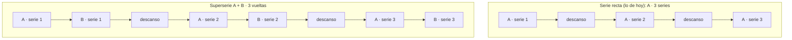

# TODO — Tipos de sesión de fuerza

Hoy la app solo sabe construir un tipo de sesión: la **serie recta** (haces una
serie de un ejercicio, descansas, y haces la siguiente). Eso deja fuera otras
formas de entrenar que son de lo más normal en un gimnasio.

Este documento tiene dos partes: el **mapa de qué otros tipos existen** y las
**decisiones ya cerradas** para el primero que ya está construido: agrupar varios
ejercicios en un mismo bloque (biserie, triserie, serie gigante).

**Estado:** el **eje 1** (los bloques encadenados) está implementado —migración
`0026_supersets.sql`—; los ejes 2 y 3 están en backlog, con lo que ya cabe sin
tocarlos marcado en su tabla.

---

## Cómo funciona hoy, en dos frases

Cada día tiene una **lista de ejercicios en orden**. Cada ejercicio guarda
cuántas series tiene y **dos descansos**: uno entre sus series y otro al
terminar el ejercicio. Al registrar, cada serie se apunta con su peso y sus
repeticiones. Un ejercicio no puede repetirse dentro del mismo día.

Eso da por hecho que un ejercicio se hace **entero** antes de pasar al
siguiente. En cuanto quieres encadenar dos, no cabe.

---

## Los tres ejes

Los tipos de entrenamiento no son una lista suelta: son **tres preguntas
distintas** que se combinan entre sí. Por eso decimos que son tres ejes: cada uno
se puede cambiar sin tocar los otros dos. (Un ejemplo de combinación: una
superserie con series descendentes usa el eje 1 y el eje 2 a la vez.)

1. **¿Qué ejercicios van pegados, sin descansar entre ellos?** → agrupación.
2. **¿Cómo se hace una serie por dentro?** → estructura de la serie.
3. **¿Manda el reloj en vez de las series?** → formatos por tiempo.

---

## Eje 1 — Agrupación: qué va pegado a qué

| Tipo | Qué es | Ejemplo |
|---|---|---|
| **Serie recta** | lo de hoy: serie → descanso → serie | 3×10 press de banca, con 120 s entre series |
| **Superserie** / **biserie** | 2 ejercicios seguidos sin descanso | Press de banca + Remo con barra |
| **Triserie** | 3 ejercicios seguidos | Press militar + Elevaciones laterales + Pájaros |
| **Serie gigante** | 4 o más seguidos, descanso al final del bloque | Sentadilla + Zancadas + Peso muerto rumano + Gemelos |
| **Circuito** | vueltas de varios ejercicios, descanso entre vueltas | 5 estaciones × 3 vueltas |

La diferencia de fondo: en la superserie el **descanso va al cerrar la vuelta**,
no al terminar cada ejercicio.

### Decisiones cerradas (implementadas)

Estas son las cinco reglas, **ya implementadas** (migración `0026`; el detalle
técnico vive en `AGENTS.md`).

**1. Cómo se sabe qué ejercicios van juntos.**
Cada ejercicio de la lista puede llevar una marca que significa **«voy pegado al
siguiente»**. Un bloque son dos o más ejercicios seguidos con la marca (el último
del bloque no la lleva, porque no tiene siguiente).
*Ejemplo:* la lista es Banca → Remo → Sentadilla. Banca lleva la marca y Remo no
→ el bloque es **Banca + Remo**; Sentadilla va suelta.
No hay «número de grupo». La marca siempre mira al vecino de al lado, así que
aunque arrastres las filas para cambiar el orden, **nunca queda un bloque partido
por el medio**.

**2. Si los dos ejercicios no tienen las mismas series.**
Se permiten distintas. El bloque funciona por **vueltas**: en cada vuelta se hace
una serie de cada ejercicio que todavía tenga series pendientes, y cuando un
ejercicio agota las suyas, se salta.
*Ejemplo:* Banca 3×10 + Remo 2×10 → vuelta 1: banca y remo · vuelta 2: banca y
remo · vuelta 3: solo banca.
Obligar a igualar las series sería algo más fácil de programar, pero perderías
poder combinar un ejercicio de 3 series con uno de 2, que es lo habitual.

**3. Cardio dentro de un bloque: no en esta primera versión.**
Un ejercicio de cardio no se puede pegar a otro; la app lo rechazará.
El motivo: la fuerza se cuenta por series («serie 1, serie 2…») y el cardio se
marca **una sola vez** («hecho»). Al hacer vueltas, el cardio no tiene una «serie
1» que repetir, así que el emparejamiento se rompe. En el editor, la marca
estará **apagada** en los ejercicios de cardio (no se podrá poner).

**4. Un bloque nunca es de un solo ejercicio.**
Un bloque nace siempre con **dos o más**, porque la marca une a un ejercicio con
el de al lado. Un ejercicio sin marca es una serie recta de toda la vida.
Dos bordes que van con esto:
- La **última fila** de la lista no puede llevar la marca (no tiene vecino
  después). Si llegara así, la app lo rechaza.
- Si **borras un miembro** del bloque, la app vuelve a ajustar las marcas: si el
  bloque se queda con uno solo, se le quita la marca.

**5. Los descansos del bloque.**
En un bloque, el descanso lo pone **solo el último ejercicio**: los de en medio
van pegados, sin descanso. Y hay **dos tiempos**, los dos en el último:
- **Entre vueltas**: el que separa una vuelta de la siguiente.
- **Al acabar el bloque**: cuando ya no quedan vueltas, antes de pasar al
  siguiente ejercicio del día.

*Ejemplo:* Banca + Remo, 3 vueltas →
banca → remo → *descanso entre vueltas* → banca → remo → *descanso entre vueltas*
→ banca → remo → *descanso al acabar el bloque*.
Los ejercicios de en medio (Banca) no tienen descanso propio; sus campos de
descanso se ocultan en el editor, así que los tiempos solo se piden una vez, en
el ejercicio que cierra la vuelta, y no hay dos valores que puedan contradecirse.

### Cómo se ve (implementado)

- **Editor del día:** cada fila lleva su marca («Encadenar» con la siguiente) y
  los miembros del bloque van dentro de una **caja tonal con la etiqueta del
  bloque** («Superserie», «Triserie», «Serie gigante»), con los descansos en el
  pie del bloque (los del último miembro).
- **Calendario:** los miembros del bloque se ven dentro de su caja, con la
  etiqueta; la fila suelta va sin ella.
- **Página de la sesión y modo sesión:** las tarjetas del bloque van juntas en su
  caja (en el registro, la cadena sale del plan del día, que es quien la guarda),
  y el modo sesión avanza vuelta a vuelta; «Descanso» arranca el de entre vueltas
  y «A continuación» nombra al siguiente miembro de la vuelta.
- **Pendiente:** la tarjeta de la sesión de «Hoy» no lleva la caja, porque
  `GET /api/day` no devuelve la marca (son dos líneas, en `api/src/routes/day.ts`
  y `web/src/routes/dia.tsx`).

### Dónde vive cada cosa (implementado)

Así quedó repartido, por si hay que volver a tocarlo:

**Base de datos**
- Una columna (`superset`) en las tablas `plan_session_exercises` y
  `template_exercises`, con valor por defecto 0. Aditiva: se puede aplicar antes
  de publicar sin romper lo que ya está funcionando (`0026_supersets.sql`).

**API** (`api/`)
- `src/blocks.ts`: las reglas de la marca (fuerza con fuerza, nunca la última
  fila) y los errores 400 que devuelve.
- `src/api-validation.ts`: acepta la marca en las plantillas y en los días.
- `src/routes/plan-sessions.ts` y `src/routes/templates.ts`: la guardan, la
  devuelven y rechazan los casos de borde.
- `src/repo.ts`: la incluye al leer los ejercicios de plantilla y de día.

**Web** (`web/src/`)
- `lib/workout.ts`: las reglas puras (`blockRange`, `blocks`,
  `normalizeSupersets`, `blockLabel`, `nextAfterSet`), los descansos del bloque y
  la precarga. Es la parte que se prueba con tests unitarios.
- `lib/plan-week.ts`, `lib/template-draft.ts`, `lib/templates.ts`: tipos y lo que
  se envía al servidor.
- `routes/plan-fuerza.tsx` (editor del día y celda del calendario),
  `routes/plantillas.tsx` y `routes/ejercicios.tsx` (el «Añadir a plantilla»).
- `components/session-mode.tsx`: el modo sesión avanza por vueltas.
- `components/ui.tsx` + `globals.css`: la caja del bloque (`Chain`, piel
  `.chain`), que usan todas las pantallas que listan ejercicios.

**Pruebas**
- API: `api/tests/supersets.test.ts`, `api/tests/plan-sessions.test.ts`,
  `api/tests/templates.test.ts`.
- Web: `workout-blocks.test.ts`, `plan-fuerza.test.tsx`, `plantillas.test.tsx`,
  `sesion.test.tsx`, `template-draft.test.ts`.
- Navegador: `e2e/tests/supersets.spec.ts`, `session-mode.spec.ts` y
  `strength.spec.ts`.

### Backlog del eje 1

- [ ] **Circuito**: vueltas explícitas (por ejemplo, 3) sobre un bloque de varios
      ejercicios. Es el mismo mecanismo, con un número de vueltas fijo y un
      descanso entre ellas.

---

## Eje 2 — Dentro de una serie

Qué forma tiene cada serie, al margen de con qué se agrupe.

| Tipo | Qué es | Ejemplo |
|---|---|---|
| **Drop set** (serie descendente) | acabas y bajas ~25 % de peso sin descansar, varias veces | Press de banca 80 → 60 → 40 kg |
| **Rest-pause** | microdescansos de 10–20 s dentro de la misma serie hasta completar las reps | Press 6+2+2 con 15 s entre tandas |
| **Cluster set** | descansos dentro de la serie de 10–30 s para no perder potencia | Sentadilla 3×(2+2+2) |
| **Al fallo / AMRAP** | la serie hasta que no puedas más, o «las repeticiones máximas» | Dominadas, 1 serie a muerte |
| **Pirámide / regresiva** | el peso cambia entre series del mismo ejercicio | 12/10/8/6 subiendo peso |

**Por qué es más costoso:** hoy el plan dice cuántas series hay y el registro
guarda **una fila por serie**. Un drop set son 3 series donde el plan dice 1, así
que habría que cambiar cómo se guarda y se valida el registro.

**Ya cabe sin cambios:** la **pirámide / regresiva**, porque cada serie ya se
guarda con su propio peso (aunque no hay objetivos distintos por serie).

- [ ] **Drop set / rest-pause / cluster** — pendiente de decidir, requiere tocar
      el registro de series.

---

## Eje 3 — Cuando manda el reloj

Aquí no son series: son tiempo y vueltas.

| Tipo | Qué es | Ejemplo |
|---|---|---|
| **EMOM** | una vuelta al empezar cada minuto | 10 min: 5 dominadas + 10 swings cada minuto |
| **AMRAP** | las vueltas que puedas en X minutos | AMRAP 12 min: 5 press + 10 remos |
| **Tabata / HIIT** | intervalos fijos (20 s de trabajo / 10 de descanso × 8) | Remo Tabata |
| **Contraste / PAP** | un ejercicio pesado y uno explosivo emparejados | Sentadilla pesada + salto al cajón |
| **Preexhausto / postexhausto** | poner el ejercicio de aislamiento antes o después del grande | Aperturas antes de press de banca |

**Ya cabe sin cambios:** preexhausto / postexhausto (es solo el orden del día).
Contraste necesita antes el eje 1, porque es una superserie con dos descansos
distintos.

- [ ] **EMOM / AMRAP / Tabata** — pendiente de decidir; sería otra forma de
      pantalla de sesión (tiempo y vueltas, no series).

---

## Resumen: qué entra y cuándo

| Necesidad | Eje | Estado |
|---|---|---|
| Superserie / biserie / triserie / gigante | 1 | **implementado** |
| Circuito | 1 | backlog |
| Pirámide / regresiva | 2 | ya cabe |
| Drop set / rest-pause / cluster | 2 | backlog (toca el registro de series) |
| Preexhausto / postexhausto | 3 | ya cabe (es orden) |
| Contraste / PAP | 1 + 3 | depende del eje 1 |
| EMOM / AMRAP / Tabata | 3 | backlog (otra forma de sesión) |
